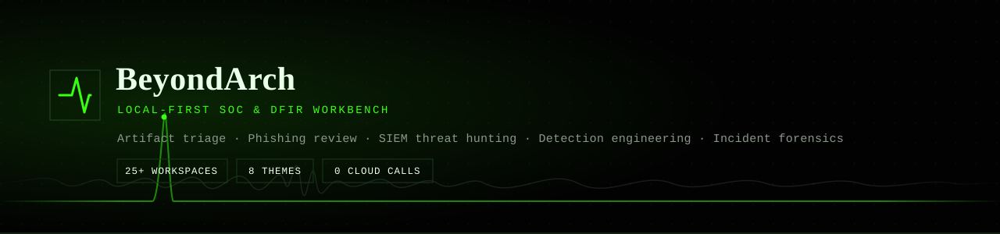
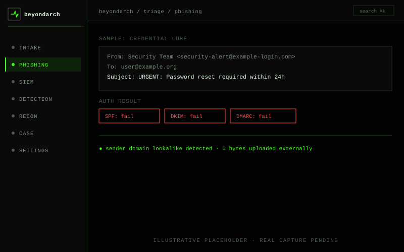
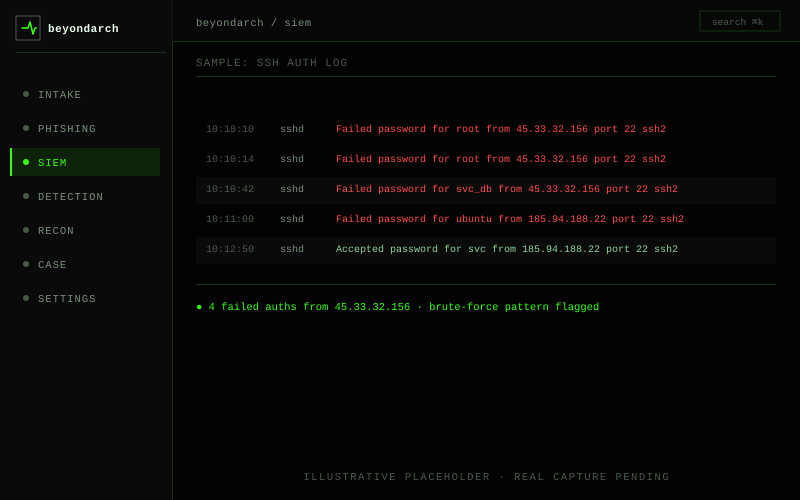
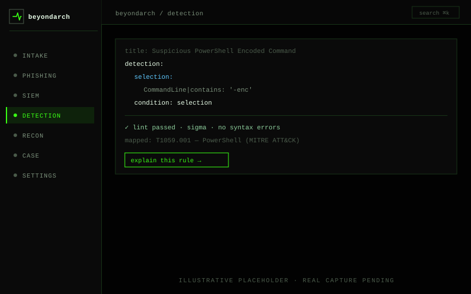
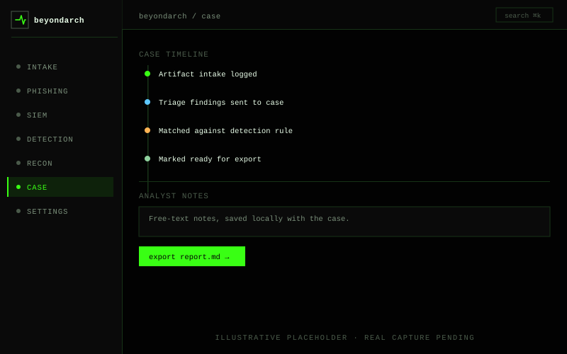
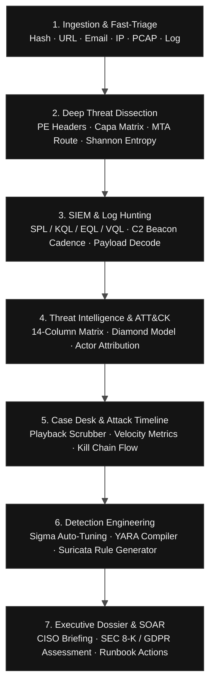
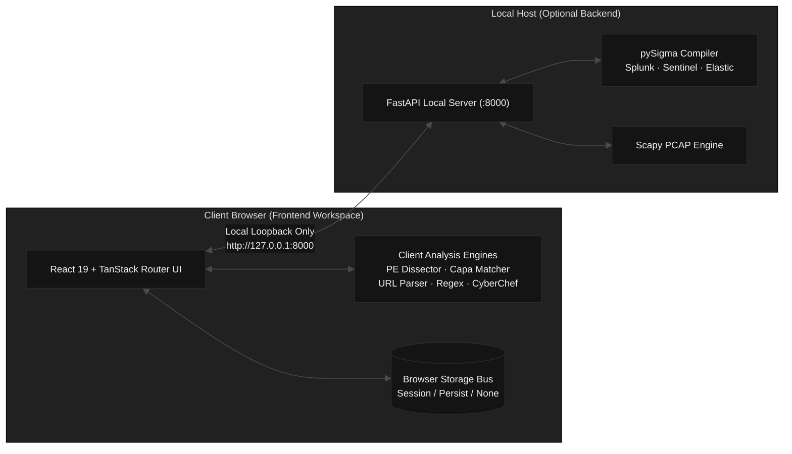

<div align="center">
  
</div>

<div align="center">

<p>
<strong>Local-First SOC Investigation, DFIR Triage & Detection Engineering Workbench</strong><br>
Privacy-preserving, offline-capable, and analyst-led — 25+ integrated workspaces, one app, your machine.
</p>

[](https://react.dev)
[](https://vite.dev)
[](https://tailwindcss.com)
[](https://typescriptlang.org)
[](https://fastapi.tiangolo.com)
[](https://python.org)
[](https://vitest.dev)

[](LICENSE)
[]()
[]()

**[Quick Start](#quick-start)** · **[Investigation Flow](#investigation-flow)** · **[Workspace Map](#workspace-map)** · **[Architecture](#system-architecture)** · **[Safety Model](#safety-model)** · **[Contributing](CONTRIBUTING.md)**

</div>

---

## Why BeyondArch

Practicing defensive security and triage operations traditionally presents an uncomfortable compromise: either deploy and maintain a complex, resource-heavy multi-VM lab, or paste sensitive corporate telemetry and artifacts into external cloud sandboxes.

**BeyondArch is the local-first alternative**: an enterprise-grade SOC and DFIR workbench that runs end-to-end on your local machine. It unifies evidence intake, static artifact dissection, multi-dialect SIEM threat hunting, ATT&CK correlation, and detection engineering into a cohesive, quiet, keyboard-driven analyst workspace.

| Capability | Cloud SOC Sandbox | Heavy VM Lab | BeyondArch |
|---|---|---|---|
| **Setup Time** | Subscription onboarding | Hours of provisioning | **Two commands (`./install.sh` && `./run.sh`)** |
| **Data Privacy** | Artifacts sent to third-party cloud | Stays in VM | **100% Local (Zero outbound telemetry)** |
| **Resource Footprint** | Low local (heavy cloud) | 16–32 GB RAM overhead | **Lightweight (~150 MB local footprint)** |
| **Pipeline Integration** | Disjointed point tools | Requires manual scripting | **Intake → Triage → SIEM → Case → Detection → Report** |
| **Query Portability** | Vendor lock-in | Single dialect | **Instant cross-translation (SPL ↔ KQL ↔ EQL ↔ VQL)** |

---

## Table of Contents

- [Why BeyondArch](#why-beyondarch)
- [Overview & Technical Stack](#overview--technical-stack)
- [Screenshots](#screenshots)
- [Investigation Flow](#investigation-flow)
- [Workspace Map (25+ Modules)](#workspace-map)
- [System Architecture](#system-architecture)
- [Quick Start](#quick-start)
- [Docker Deployment](#docker-deployment)
- [Safety Model & Boundaries](#safety-model--boundaries)
- [Privacy & Storage Modes](#privacy--storage-modes)
- [Repo Layout](#repo-layout)
- [Quality Engineering & Verification](#quality-engineering--verification)
- [Settings & Customization](#settings--customization)
- [FAQ](#faq)
- [Contributing](#contributing)
- [License](#license)

---

## Overview & Technical Stack

BeyondArch is built with modern, battle-tested technologies designed for low latency, zero horizontal layout shift, and offline resilience:

| Layer | Technologies |
|---|---|
| **Frontend Framework** | React 19 · Vite 8 · TypeScript 5.8 · TanStack Router (file-based routing) |
| **Styling & Design System** | Tailwind CSS v4 · Radix UI primitives · Lucide Icons · CSS variable themes |
| **Visualizations & Graphs** | XYFlow (`@xyflow/react`) topology engine · Recharts telemetry histograms |
| **Backend API (Optional)** | FastAPI 0.136 · Uvicorn · Pydantic v2 · Python 3.10+ |
| **Detection & PCAP Engines** | pySigma (Splunk, Elastic, Sentinel) · Scapy · tldextract · dnspython |
| **Testing & Verification** | Vitest 4 (87 test suites, 859 tests) · Playwright (multi-viewport verification) |
| **Platforms** | Linux (Arch, Debian, Ubuntu, Fedora) · macOS (Homebrew) · Windows (PowerShell) |

---

## Screenshots

<table>
<tr>
<td align="center" width="50%">
<br/>
<sub><b>Evidence Intake & Fast-Triage</b> — Multi-observable parser with live defang/refang</sub>
</td>
<td align="center" width="50%">
<br/>
<sub><b>SIEM Hunting Workspace</b> — Cross-dialect query translation & facet filtering</sub>
</td>
</tr>
<tr>
<td align="center" width="50%">
<br/>
<sub><b>Detection Studio & Sandbox</b> — Sigma/YARA/Suricata authoring & noise suppression</sub>
</td>
<td align="center" width="50%">
<br/>
<sub><b>Case Management & Dossiers</b> — Attack timeline, Diamond Model & CISO briefings</sub>
</td>
</tr>
</table>

---

## Investigation Flow

BeyondArch organizes incident investigation as a continuous, compounding lifecycle rather than disconnected silos:



Every workspace connects through an in-memory and local storage handoff bus (`beyondlabs.pendingArtifact` and `beyondlabs.locker`), allowing you to pivot seamlessly between analyzers without losing state or context.

---

## Workspace Map

BeyondArch provides **over 25 specialized workspaces** categorized into six operational pillars:

### 1. Command Deck & Fast-Triage
- **Command Deck (`/`)**: Central operational overview featuring the DEFCON Threat Posture bar, 5-KPI telemetry ribbon (MTTA, MTTD, MTTR, Active Incidents, Dwell Time), active case sentinel, and chronological security feed.
- **Universal Fast-Triage Dock**: Omnibar input accessible via `/` hotkey for instant indicator classification (IP, Domain, CVE, Hash, Encoded Command) with one-click case attachment.

### 2. Intake & Threat Triage
- **Evidence Intake (`/intake`)**: Multi-observable parser supporting raw log dumps, syslog streams, and threat scenario presets (APT28, Volt Typhoon, BlackCat ransomware).
- **Automated Triage Analysis (`/triage`)**: Queue disposition interface with explainable confidence scoring, decision criteria rationale, and containment recommendations.
- **Phishing Email Dissector (`/phishing`)**: Full email header inspection, SPF/DKIM/DMARC authentication matrix, transit MTA hop timeline with clock-skew detection, link discrepancy grid, and phishing containment console.
- **Deep URL Dissector & Defense Playbook (`/url`)**: RFC 3986 component anatomy, homograph/punycode spoof detector, Shannon entropy calculation, and automated mitigation playbooks.
- **Malware & File Forensics (`/file`, `/attachment`)**: Static PE header dissection (DOS/NT/Optional headers, sections, imports/exports), Capa ATT&CK capability matrix, simulated detonation trace, Office/PDF macro extractor, hex inspector, and automated YARA rule compiler.
- **Windows Security & Sysmon Event Analyzer (`/logs`)**: Dedicated forensic review of Windows Security Event IDs (4688, 4624, 4672, 7045) and Sysmon telemetry (Process Create, Network Connect, Image Load), complete with process tree parent-child visualization.
- **PCAP Packet Forensics (`/pcap`)**: Wireshark display filter bar, TCP stream reassembly modal, Zeek DNS/Connection log viewer, automated Suricata IDS signature synthesis, and perimeter isolation script generation.

### 3. Investigation, Case Management & Threat Intel
- **Incident Case Desk (`/case`)**: Full-featured case management supporting evidence binders, chronological notes, and automated generation of multi-audience deliverables:
  - **CISO Executive Incident Briefing**: Strategic board-ready impact narrative.
  - **SOC Engineering Containment Checklist**: Tactical IP tables, EDR isolation, and Entra ID session revocation scripts.
  - **DFIR & Law Enforcement Handover Package**: Cryptographic IOC hash digest and chain-of-custody attestations conforming to ISO/IEC 27037.
  - **Regulatory Compliance Evaluator**: Form 8-K Item 1.05 (SEC 4-Day mandate) and GDPR Art. 33 / CCPA breach disclosure evaluator.
  - **SOC Shift Handover Protocol (SOC-OP-04, `/activity`)**: Standard operational watch turnover log with DEFCON posture, uncontained case matrix, and digital sign-off.
- **Master Attack Timeline (`/timeline`)**: Interactive attack playback scrubber, velocity metrics (dwell time, events/min, milestone counters), time-slice filtering, and automated MITRE tactic phase flow.
- **Cross-Case Intrusion Topology Graph (`/investigation`)**: Interactive node-link topology powered by XYFlow mapping shared C2 infrastructure, blast radius metrics, and pivot relationships.
- **Threat Actor Attribution & Intelligence (`/threat-actors`, `/intel`)**: Attribution scoring engine matching observed TTPs against known adversaries, targeted CVE vulnerability tracker, TLS/JA3/JARM fingerprinter, and STIX 2.1 JSON exporter.

### 4. Detection Engineering & SIEM
- **SIEM Threat Hunting Studio (`/siem`)**: Search bar supporting Splunk SPL, Microsoft Sentinel KQL, and Elastic queries with syntax highlighting, field facet histograms, decoded payload popovers, and deterministic C2 beaconing cadence detector.
- **Cross-SIEM Query Translator**: Real-time transpiler converting hunting queries between Splunk SPL, Sentinel KQL, Elastic EQL, and Velociraptor VQL.
- **Detection Studio & Sandbox (`/detection`)**: Multi-dialect rule workbench for Sigma, YARA, Suricata IDS, and KQL rules with live simulation against historical events, AST validation, and canary deployment checklists.
- **MITRE ATT&CK Enterprise Matrix (`/mitre`)**: Interactive 14-column tactic grid with technique coverage heatmaps and navigator layer export/import.
- **Sigma Rule Tester & Transpiler (`/sigma-tester`)**: Real-time pySigma compiler translating rules into 5 enterprise SIEM backends with noise risk and false-positive estimation.

### 5. DFIR Operations & Engineering Toolkit
- **SOAR Operations Deck (`/operations`)**: Pre-built incident response runbooks (malware containment, phishing takedown, credential compromise, ransomware isolation) with step-by-step interactive execution and timeline auditing.
- **Universal Log Parser Station (`/parser`)**: Multi-format IOC extractor, regex field parser, and in-memory obfuscation decoders (Base64, Hex, URL, XOR).
- **CyberChef Recipe Station (`/chef`)**: 50+ offline cryptographic and string transformations, Shannon entropy visualization, magic byte sniffer, and pre-configured SOC deobfuscation presets.
- **Forensic Diff Engine (`/diff`)**: Side-by-side artifact, rule, and script comparison with character-level diffing.
- **SOC Regex Playground (`/regex-playground`)**: Real-time regular expression tester with SOC-specific token highlighting and pre-tested detection patterns.
- **Threat Hunting Playbook Arsenal (`/snippets`)**: Curated multi-dialect query catalog with 1-click SIEM execution and automated Sigma rule tuning.
- **SOC Standard Operating Procedures & Guide (`/guide`)**: Curated runbook blueprints, Windows event ID cheatsheets, and command cheat cards.

### 6. System & Workspace Customization
- **Workspace Settings (`/settings`)**: Theme gallery with 8 professional palettes, 16 accent presets, 12 monospaced typography pairings, density controls, customizable sidebar grouping, and privacy storage controls.

---

## System Architecture



- **Zero Cloud Leakage**: No external analytics, no telemetry trackers, no phone-home mechanisms.
- **Graceful Offline Degradation**: The frontend functions as a fully capable static workstation even if the Python backend is stopped.

---

## Quick Start

### Prerequisites
- **Node.js**: v18.0.0 or higher (v20+ recommended)
- **Python**: v3.10 or higher
- **npm**: v9.0.0 or higher

### Linux & macOS

The setup script automatically detects your package manager (`pacman`, `apt`, `dnf`, or `brew`):

```bash
# 1. Clone repository
git clone https://github.com/kripy17/BeyondArch.git
cd BeyondArch

# 2. Run automated installer
./install.sh

# 3. Start both backend and frontend
./run.sh
```

To run only the frontend without backend dependencies:
```bash
./run.sh --frontend-only
```

### Windows (PowerShell)

```powershell
# 1. Run automated installer
.\install.ps1

# 2. Launch application
.\run.ps1
```

### Accessing the Workspaces

| Service | Local URL | Description |
|---|---|---|
| **Frontend UI** | `http://localhost:5173` | React 19 Workspace Shell |
| **Backend API** | `http://localhost:8000` | FastAPI Analysis Server |
| **Interactive Docs** | `http://localhost:8000/docs` | Swagger / OpenAPI Documentation |

---

## Docker Deployment

BeyondArch includes a container configuration that publishes strictly to host loopback (`127.0.0.1`):

```bash
# Build and run containers
docker compose up --build

# Run in background
docker compose up -d
```

Frontend will be accessible at `http://localhost:80` and backend at `http://localhost:8000`.

---

## Safety Model & Boundaries

BeyondArch is purposefully designed for defensive security analysts:

- **No Live Malware Detonation**: All file dissections (PE, Office, PDF) are performed statically. No hostile binary execution occurs.
- **Safe Network Analysis**: PCAP inspections and stream followers analyze captured `.pcap` files without broadcasting hostile payloads onto your local network.
- **Bounded Tooling**: Defense and containment scripts generate sanitized commands (iptables, PowerShell) for analyst review rather than unprompted background execution.
- **No Deceptive Threat Intelligence**: External threat feeds are opt-in. When an external source is not configured, BeyondArch transparently communicates this rather than synthesizing fabricated reputations.

---

## Privacy & Storage Modes

You have complete control over how your analysis state is stored on your machine (configured in **Settings → Storage & Backup**):

| Mode | Lifecycle | Best For |
|---|---|---|
| **Session Only** (Default) | In-memory and session storage; cleared automatically when the browser tab closes. | Daily production triage and sensitive evidence handling. |
| **Persist** | Stored in browser `localStorage`; persists across browser restarts. | Multi-day case investigations and customized detection rules. |
| **None** | Strictly transient; no investigation data or history is written to disk. | Ephemeral inspections and strict zero-trace requirements. |

Full JSON workspace backups can be exported or imported at any time via the settings console.

---

## Repo Layout

```
BeyondArch/
├── frontend/                   React 19 + Vite 8 client application
│   ├── src/
│   │   ├── routes/             TanStack Router type-safe routed workspaces
│   │   ├── components/         SOC UI components (Command Deck, SIEM, Dossiers, Modals)
│   │   ├── lib/                Client engines (PE parser, Sigma tuner, timeline, handoff)
│   │   ├── data/               MITRE ATT&CK data, detection library, case factories
│   │   └── api/                Backend REST client connectors
│   └── package.json            Dependencies and npm scripts
├── backend/                    FastAPI analysis server
│   ├── app/
│   │   ├── routers/            Endpoints for PCAP, Sigma translation, and reputation
│   │   └── services/           pySigma and Scapy analysis engines
│   ├── requirements.txt        Python dependencies (fastapi, pysigma, scapy)
│   └── pyproject.toml          Ruff and pytest configuration
├── scripts/                    Setup utilities and terminal UI helpers
├── install.sh / install.ps1    Cross-platform setup wizards
├── run.sh / run.ps1            Launch scripts with frontend/backend flags
├── doctor.sh / doctor.ps1      System health check diagnostics
├── docker-compose.yml          Isolated container deployment
└── README.md                   Project documentation
```

---

## Quality Engineering & Verification

BeyondArch enforces strict test coverage, zero-warning typechecking, and responsive layout invariants:

```bash
# 1. Run full unit & integration test suite (87 files, 859 tests)
npm run test --prefix frontend

# 2. Run TypeScript compiler check
npm run typecheck --prefix frontend

# 3. Verify production bundle build
npm run build --prefix frontend

# 4. Run system health diagnostics
./doctor.sh
```

### Responsive Invariant Guarantee
All workspaces are verified via Playwright to ensure **zero horizontal layout overflow** (`scrollWidth === clientWidth`) and zero runtime JavaScript exceptions across both **1440px desktop** and **390px mobile** viewports.

---

## Settings & Customization

BeyondArch includes an integrated theming engine tailored for long operational watch shifts:

- **8 Hand-Crafted Themes**: Terminal Noir (default), SOC Console, Midnight Ops, Editorial Dark, Solar Flare, Synthwave Grid, Late Edition, and Broadsheet.
- **16+ Accent Colors**: Emerald, Amber, Cyan, Rose, Sky, Violet, Indigo, and custom hex overrides.
- **12+ Typography Pairs**: High-legibility monospaced fonts (JetBrains Mono, Fira Code, IBM Plex Mono, Space Grotesk, Inter).
- **Density Controls**: Comfortable, Compact, or Ultra-Dense telemetry spacing.
- **Custom Navigation**: Pin favorite tools, reorder functional blocks, or collapse sidebar groups.

---

## FAQ

**Does BeyondArch transmit my artifacts or logs to external servers?**  
No. Analysis is performed strictly inside your browser and your local loopback FastAPI instance (`127.0.0.1`).

**Can BeyondArch run without the Python backend?**  
Yes. Running `./run.sh --frontend-only` launches the React workspace. All client-side analyzers (PE dissector, CyberChef, URL parser, timeline, case management, and regex playground) function completely offline. The Python backend is only needed for pySigma compilation and raw Scapy packet dissection.

**Is browser storage secure enough for formal evidence custody?**  
Browser storage is intended for active workspace convenience. For formal chain-of-custody preservation, export your case dossiers and timeline packages using the built-in JSON / Markdown export features.

**Does BeyondArch replace a production SIEM or EDR?**  
No. BeyondArch is an analyst-led triage and investigation workbench. It complements enterprise SIEMs (Splunk, Microsoft Sentinel, Elastic) by providing zero-friction triage, query cross-translation, and rule authoring before deploying detections to production fleets.

---

## Contributing

Contributions are welcome. Please read [CONTRIBUTING.md](CONTRIBUTING.md) for development guidelines, coding standards, and our PR workflow.

1. Fork the repository.
2. Create a feature branch (`git checkout -b feature/sigma-enhancement`).
3. Ensure all tests pass (`npm run test --prefix frontend` and `npm run typecheck --prefix frontend`).
4. Commit your changes and open a Pull Request.

---

## License

BeyondArch is released under the **MIT License**. See [LICENSE](LICENSE) for details.

---

<div align="center">

Built for security analysts who demand local control, speed, and privacy.

[Report Issue](https://github.com/kripy17/BeyondArch/issues) · [Request Feature](https://github.com/kripy17/BeyondArch/issues) · [Contributing Guide](CONTRIBUTING.md)

</div>
