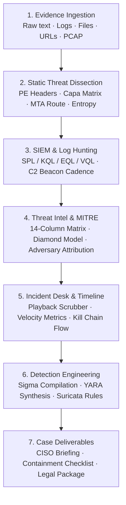
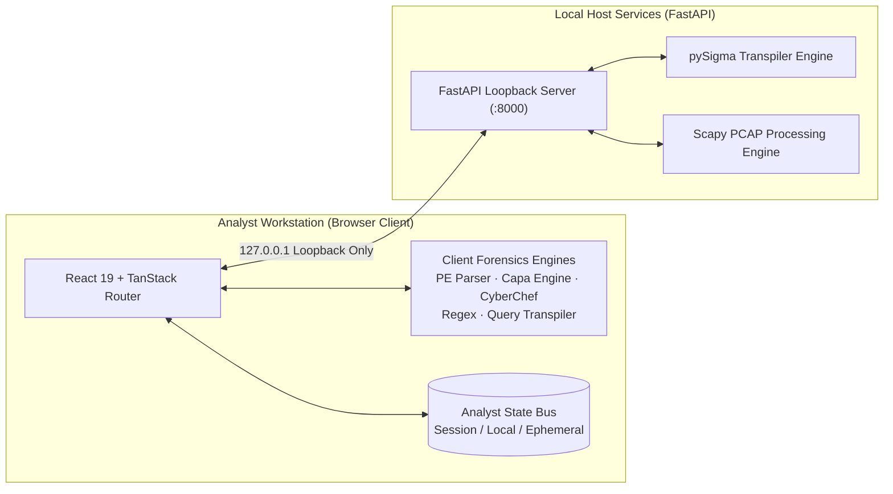

<div align="center">

# BeyondArch

**Local-First SOC Investigation, DFIR Triage & Detection Engineering Workbench**

Privacy-preserving, offline-capable, and analyst-led — 25+ integrated workspaces running entirely on your machine.

[](LICENSE)
[](https://github.com/kripy17/BeyondArch/actions)
[](https://react.dev)
[](https://typescriptlang.org)
[](https://vite.dev)
[](https://tailwindcss.com)
[](https://fastapi.tiangolo.com)
[](https://python.org)
[](https://vitest.dev)
[](#privacy--storage-model)

[Quick Start](#quick-start) • [Workspaces](#core-workspaces) • [Investigation Pipeline](#investigation-pipeline) • [Architecture](#architecture) • [Docker](#docker-deployment) • [Contributing](CONTRIBUTING.md)

</div>

---

## Overview

Defensive security workflows often force an unacceptable choice: manage heavy, fragile multi-VM labs that consume tens of gigabytes of RAM, or paste sensitive enterprise indicators into cloud-hosted platforms.

**BeyondArch** provides a local-first alternative. It delivers an integrated, distraction-free environment for incident response, threat hunting, and detection engineering on your own workstation:

- **100% Local Execution**: Analysis runs strictly in your browser and local loopback API (`127.0.0.1`). Zero telemetry, zero external phone-home calls.
- **Unified Analyst Bus**: Pivot indicators seamlessly across intake, timeline, SIEM queries, and case dossiers without re-pasting data.
- **Instant SIEM Cross-Translation**: Convert detection logic and hunt queries on the fly between Splunk SPL, Microsoft Sentinel KQL, Elastic EQL, and Velociraptor VQL.
- **Safe Static Forensics**: Dissect PE files, Office documents, email headers, and PCAP streams without risking hostile execution.

| Operational Dimension | Cloud Triage Services | Heavy Multi-VM Labs | BeyondArch |
|---|---|---|---|
| **Data Privacy** | Telemetry sent to third parties | Stays inside VM | **100% On-Device (No outbound traffic)** |
| **Startup Overhead** | Cloud auth & subscription setup | Minutes of booting & snapshots | **Sub-second launch (`./run.sh`)** |
| **Memory Footprint** | Low local (heavy remote) | 16–32 GB RAM required | **~150 MB local footprint** |
| **Workflow State** | Fragmented SaaS interfaces | Manual file sharing & scripts | **Single connected case & graph bus** |
| **Query Flexibility** | Single proprietary syntax | Vendor-specific agents | **Multi-dialect (SPL ↔ KQL ↔ EQL ↔ VQL)** |

---

## Investigation Pipeline

Investigations in BeyondArch follow a compounding lifecycle where every stage informs the next:



---

## Core Workspaces

BeyondArch groups **over 25 specialized modules** into five operational pillars:

### 1. Evidence Intake & Triage
* **Universal Intake (`/intake`)**: Ingest logs, syslog dumps, emails, and threat feeds. Includes realistic APT presets (Volt Typhoon, BlackCat, APT28).
* **Automated Triage (`/triage`)**: Severity-scoring triage desk with explainable containment recommendations.
* **Email & Phishing Dissector (`/phishing`)**: Full RFC 5322 header parsing, SPF/DKIM/DMARC authentication verification, MTA transit timeline, and link discrepancy analysis.
* **URL & Domain Dissector (`/url`)**: RFC 3986 component decomposition, punycode/homograph spoof detection, and Shannon entropy calculation.
* **File & Malware Forensics (`/file`, `/attachment`)**: Static PE header inspection (DOS/NT/Optional headers, sections, exports), Capa ATT&CK capability matching, macro extraction, and hex preview.
* **Windows & Sysmon Logs (`/logs`)**: Security event analysis (Event IDs 4624, 4688, 4672, 7045) and Sysmon process tree inspection.
* **PCAP Network Forensics (`/pcap`)**: Wireshark display filter evaluation, TCP stream follower, Zeek log viewer, and Suricata IDS rule extraction.

### 2. Incident Desk & Intelligence
* **Incident Case Management (`/case`)**: Evidence aggregation, timeline markers, and automated multi-audience report generators:
  * **CISO Executive Briefing**: Strategic executive impact overview.
  * **SOC Containment Action List**: Tactical firewall, EDR, and account isolation commands.
  * **Chain-of-Custody Dossier**: Cryptographic IOC hash digests conforming to ISO/IEC 27037 standards.
  * **Regulatory Compliance Evaluator**: Form 8-K (SEC 4-day disclosure) and GDPR Article 33 assessment.
* **Master Attack Timeline (`/timeline`)**: Attack progression scrubber with event velocity metrics, phase filtering, and dwell-time calculation.
* **Intrusion Topology Graph (`/investigation`)**: Interactive node-link graph powered by XYFlow mapping shared infrastructure and blast radius.
* **Threat Intelligence & Attribution (`/threat-actors`, `/intel`)**: Adversary profiling matching observed TTPs against known threat groups with STIX 2.1 export.

### 3. Threat Hunting & SIEM
* **SIEM Hunting Console (`/siem`)**: Search interface supporting Splunk SPL, Microsoft Sentinel KQL, and Elastic queries with facet histograms and payload deobfuscation.
* **Cross-Dialect Query Transpiler**: Instant conversion across Splunk SPL, Microsoft Sentinel KQL, Elastic EQL, and Velociraptor VQL.
* **MITRE ATT&CK Matrix (`/mitre`)**: Interactive 14-column tactic grid with coverage heatmaps and ATT&CK Navigator JSON import/export.
* **Shift Handover Protocol (`/activity`)**: Standard operational turnover log (SOC-OP-04) recording current DEFCON posture and open cases.

### 4. Detection Engineering Studio
* **Detection Sandbox (`/detection`)**: Multi-rule authoring suite for Sigma, YARA, and Suricata with syntax highlighting and event simulation.
* **Sigma Tester & Compiler (`/sigma-tester`)**: Real-time pySigma transpiler targeting 5 enterprise SIEM backends with false-positive estimation.
* **Threat Hunting Arsenal (`/snippets`)**: Curated repository of production hunting queries organized by adversary technique.

### 5. DFIR Utilities & SOAR
* **SOAR Operations Hub (`/operations`)**: Interactive containment runbooks for malware outbreak, phishing response, credential compromise, and ransomware isolation.
* **CyberChef Station (`/chef`)**: 50+ offline string, cryptographic, and encoding transformations with magic-byte identification.
* **Universal Log Parser (`/parser`)**: High-speed regex extraction engine for IPs, URLs, hashes, domains, and Base64 payloads.
* **Forensic Diff Engine (`/diff`)**: Visual side-by-side comparison for configs, script revisions, and decoded payloads.
* **Regex Playground (`/regex-playground`)**: SOC-specific regex validation sandbox with token breakdown.

---

## Quick Start

### Prerequisites
* **Node.js**: v18.0.0+ (v20+ recommended)
* **Python**: v3.10+ (optional, needed for backend pySigma & Scapy services)
* **npm**: v9.0.0+

### Linux & macOS

```bash
# 1. Clone repository
git clone https://github.com/kripy17/BeyondArch.git
cd BeyondArch

# 2. Run automated installer
./install.sh

# 3. Launch application
./run.sh
```

To run exclusively in frontend mode without local Python dependencies:
```bash
./run.sh --frontend-only
```

### Windows (PowerShell)

```powershell
# 1. Run setup wizard
.\install.ps1

# 2. Start services
.\run.ps1
```

### Local Endpoints

| Component | URL | Notes |
|---|---|---|
| **Frontend Workspace** | `http://localhost:5173` | React 19 UI shell |
| **Backend REST API** | `http://localhost:8000` | FastAPI analysis services |
| **Interactive API Docs** | `http://localhost:8000/docs` | OpenAPI / Swagger specification |

---

## Docker Deployment

BeyondArch includes isolated container support bound strictly to the local loopback interface (`127.0.0.1`):

```bash
# Build and start services
docker compose up --build -d

# Check container status
docker compose ps

# View service logs
docker compose logs -f
```

Frontend is accessible at `http://localhost:80` and backend at `http://localhost:8000`.

---

## Architecture



### Privacy & Storage Model
All application state is configurable under **Settings → Storage & Privacy**:
- **Session Only (Default)**: State lives in session memory and is destroyed when the browser tab closes.
- **Persistent Mode**: State is stored in local browser storage (`localStorage`) across workstation restarts.
- **Transient Mode**: Completely in-memory execution; leaves zero trace on local storage.
- **Full Backup**: Export and import complete investigation workspaces as encrypted or raw JSON.

### Security Guarantees
- **Static Inspection**: All binary and script analyzers operate statically. Hostile code is never detonated or invoked.
- **Safe Network Capture**: PCAP streams are parsed passively from dump files; no network packets are transmitted.
- **No Third-Party Telemetry**: BeyondArch contains zero Google Analytics, tracking pixels, or remote call-home beacons.

---

## Quality Engineering & Verification

The project is governed by strict test coverage and responsive invariants:

```bash
# Run unit & integration test suites (87 test suites, 859 tests)
npm run test --prefix frontend

# Verify TypeScript compilation
npm run typecheck --prefix frontend

# Run production asset build
npm run build --prefix frontend

# Run backend Python tests (224 tests)
cd backend && pytest tests/ -v
```

All workspace views are verified to guarantee **zero horizontal scroll overflow** (`scrollWidth === clientWidth`) across both 1440px desktop displays and 390px mobile viewports.

---

## Repository Layout

```
BeyondArch/
├── frontend/                   React 19 client application
│   ├── src/
│   │   ├── routes/             TanStack Router routed workspace views
│   │   ├── components/         Domain primitives, layout shells & modals
│   │   ├── lib/                Forensic engines (PE, Sigma, PCAP, email, timeline)
│   │   ├── data/               MITRE ATT&CK catalogs & detection fixtures
│   │   └── api/                FastAPI client adapters
│   └── package.json            Client dependencies and build scripts
├── backend/                    FastAPI Python server
│   ├── app/
│   │   ├── routers/            REST routes for PCAP, Sigma, and threat lookups
│   │   └── services/           pySigma and Scapy analysis engines
│   ├── requirements.txt        Production Python requirements
│   └── pyproject.toml          Ruff and Pytest configuration
├── docs/                       Architecture decisions, specifications & roadmaps
├── samples/                    Safe test logs, phishing emails & practice artifacts
├── scripts/                    Platform installation, health check & UI helpers
├── docker-compose.yml          Isolated multi-service deployment
├── CONTRIBUTING.md             Contribution guidelines and standards
├── SECURITY.md                 Security and responsible disclosure policy
└── LICENSE                     MIT License
```

---

## License

BeyondArch is open-source software licensed under the [MIT License](LICENSE).
